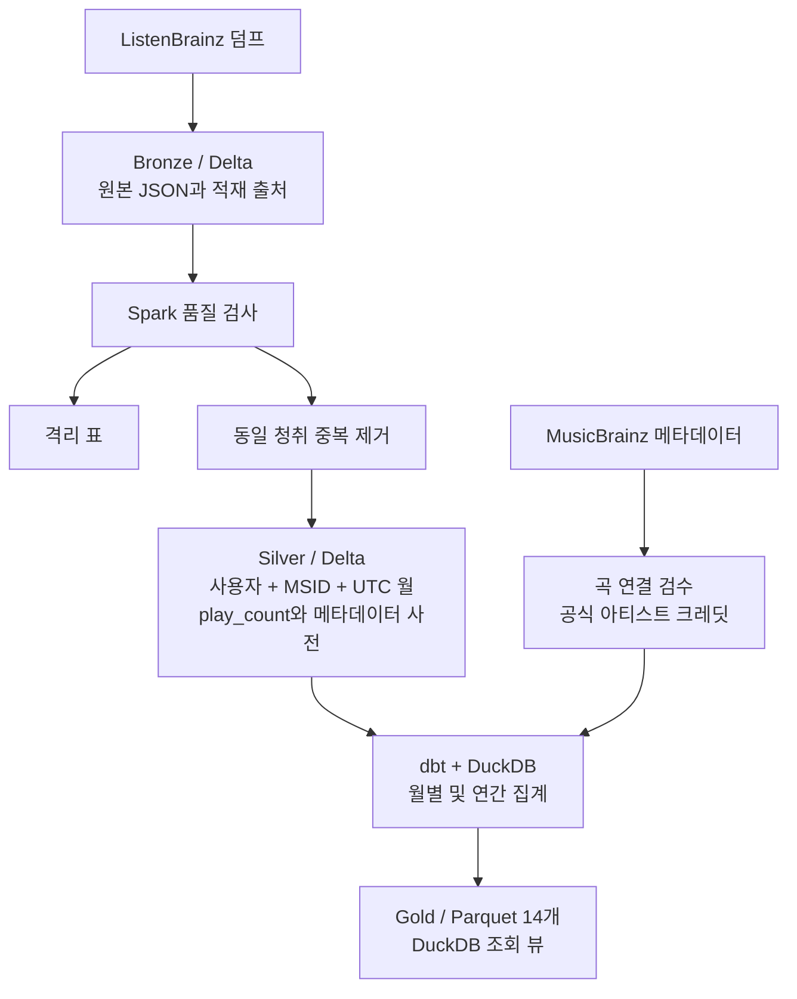

# Flux

**1.6억 건의 음악 청취 기록을 정제하고, 반복 청취와 청취자 분포를 함께 분석하는 데이터 파이프라인입니다.**

ListenBrainz의 공개 청취 덤프와 MusicBrainz의 공식 메타데이터를 사용합니다. Spark와 Delta Lake로 원본 보존과 정제를 처리하고, dbt와 DuckDB로 월별 및 연간 분석 마트를 만듭니다. 데이터가 바뀌었을 때의 재계산, 품질 검사와 실행 이력까지 같은 입력 버전을 기준으로 연결하는 것이 목표입니다.

| 검증한 입력 | 월별 Silver | 보존한 청취 횟수 | Gold 마트 |
| --- | --- | --- | --- |
| Bronze **162,679,797행** | **80,563,985행** | **157,351,363회** | 월별 7개 + 연간 7개 |

[현재 상태](docs/status.md) / [실행 안내](docs/running.md) / [집계 정책](docs/monthly_gold.md) / [검증 기록](docs/measurements/)

## 왜 만들었나

청취 수가 높다는 사실만으로 많은 사람이 듣는 음악이라고 볼 수는 없습니다. 초기 분석에서는 RM 청취의 약 58.2%가 한 계정에 집중된 사례를 발견했습니다. 반복 청취를 지우면 실제 청취 횟수를 잃고, 청취 수만으로 순위를 매기면 계정별 편중을 놓칩니다. 그래서 반복은 `play_count`로 보존하고, 대표 순위는 고유 청취 계정 수로 정했습니다. [초기 비교 결과](docs/measurements/2026-10-18-artist-ranks.md)에 당시 입력과 분석 범위를 남겼습니다.

같은 음악이 서로 다른 이름이나 식별자로 들어오고, 아티스트 연결에도 오류가 있다는 문제도 확인했습니다. 곡 연결과 공식 아티스트 귀속을 별도로 관리하며, Live, Remix와 Sped Up 같은 버전을 구분합니다. 확인하지 못한 연결은 보류하고 커버리지에 드러내도록 설계했습니다.

## 데이터 흐름



Bronze는 재처리할 수 있도록 원본을 보존합니다. Silver는 품질 격리와 동일 청취 중복 제거를 거친 뒤 사용자, MSID, UTC 청취 월별 횟수로 압축합니다. 도착 시각이 아닌 청취 시각이 기준이므로 늦게 들어온 기록은 과거 월의 집계를 바꿀 수 있습니다.

월별 Silver와 메타데이터 사전, 격리 표의 활성 데이터 파일은 **5.15GB**입니다. 이전 상세 모델과 전체 기간 횟수 표 및 격리 표의 **15.54GB** 대비 **66.9% 줄어든 구성**입니다. 보존 중인 Bronze와 이전 검증본을 포함한 전체 디스크 사용량의 감소를 뜻하지는 않습니다. [월별 모델 전환 결과](docs/rebuild_30seconds.md#월별-delta-실제-생성)를 참고하세요.

## 집계 정책

| 판단 | 적용 방식 |
| --- | --- |
| 짧은 재생 | 숫자로 해석한 `ms_played`가 30,000 미만이면 격리합니다. 시간이 없거나 숫자로 해석할 수 없으면 유지하고 품질 현황에 남깁니다. |
| 동일 청취 | 사용자, MSID, 청취 시각이 모두 같은 제출을 중복 제거합니다. 품질 격리가 먼저입니다. |
| 반복 청취 | 시각이 다른 청취는 보존하고 사용자 + MSID + UTC 월별 `play_count`에 합산합니다. |
| 곡 연결 | MSID를 완전한 곡 식별자로 가정하지 않습니다. 공식 ID와 제목 및 버전 검수로 확인한 후보만 연결하고 원본 식별자는 보존합니다. 악센트 제거 등 이름 정규화는 후보 탐색에 사용합니다. |
| 아티스트 귀속 | 공식 크레딧의 메인과 피처링 아티스트에게 각각 청취 수를 부여합니다. 제작진 관계는 포함하지 않습니다. |
| 버전 분리 | Live, Remix와 Sped Up 등을 원곡 키에 흡수하지 않습니다. 아티스트 전체 지표에는 공식 귀속된 각 버전의 청취를 포함합니다. |
| 순위와 기간 | 고유 계정 수로 `RANK`를 계산하고 동률은 공동 순위, 표시는 이름순으로 정렬합니다. 연간 청취자 수는 월별 수를 더하지 않고 사용자별 연간 기여에서 다시 계산합니다. |

짧은 재생 격리는 건너뛴 청취를 정제하는 정책입니다. RM 사례처럼 반복이 집중된 기록은 청취자 수와 청취 수, 계정별 비중을 함께 보는 방식으로 다룹니다. 두 판단은 별개입니다.

## 분석 마트

다음 7개 마트를 월별과 연간으로 각각 제공합니다. 청취 수 순위도 비교용으로 남기며, 계정별 기여에서 최대 계정 비중과 집중도(HHI), 유효 청취자 수를 계산합니다.

| 마트 | 분석 단위와 주요 지표 |
| --- | --- |
| `song_metrics` | 곡별 청취 수, 청취자 수, 두 기준의 순위와 계정 편중 |
| `artist_metrics` | 공식 아티스트별 청취 수, 청취자 수와 계정 편중 |
| `artist_song_metrics` | 아티스트 안의 곡 순위, 곡별 청취 비중과 청취자 도달 비율 |
| `variant_metrics` | 버전 조합별 청취 수, 청취자 수와 비중 |
| `listener_metrics` | 가명화한 계정별 청취 수, 곡 키 수와 최다 청취 곡 비중 |
| `coverage` | 기간별 전체 청취와 공식 아티스트 귀속 범위 |
| `identity_coverage` | 곡 식별 검수 상태별 청취와 계정 수 |

아티스트가 연결되지 않은 기록도 곡, 계정과 커버리지 마트에 남습니다. 현재 고정 입력에서 공식 아티스트에 귀속된 청취는 **25,584,701회, 약 16.26%**입니다. 아티스트 순위는 이 확인 범위의 결과이며, 참여 아티스트에게 각각 횟수를 부여하므로 아티스트별 청취 합은 전체 청취 수보다 커질 수 있습니다. [마트 정의와 조회 예시](docs/monthly_gold.md)에 지표의 분모와 해석 범위를 설명했습니다.

## 검증과 실행 근거

입력 Delta 버전과 규칙을 고정하고, 새 경로에서 만든 결과를 기존 결과 및 독립 계산과 대조합니다. 완료 표시와 품질 검사를 통과한 결과만 사용하며, 아래 검증에서 운영 데이터의 조회 경로는 교체하지 않았습니다.

| 검증 | 확인한 범위와 결과 |
| --- | --- |
| [dbt 전체 대조](docs/dbt_full.md) | 월별 Silver 80,563,985행에서 24개 모델과 데이터 검사 145개를 실행했습니다. Gold 14개가 기존 결과의 모든 키와 값 대조를 통과했고 최종 Parquet의 SHA-256도 일치했습니다. |
| [품질 계약](docs/quality_contract.md)과 [GX](docs/gx_quality.md) | 고정 표본 6,469행, 113,368회에서 계약 17개 규칙을 검사해 실패 0, 경고 2, 적용 제외 1을 기록했습니다. GX는 이 중 3개 규칙의 12개 검사를 담당하며, 불량과 변조 결과의 전환 차단도 검증했습니다. |
| [Silver CDF와 Gold 연결](docs/silver_cdf_gold.md) | 수정과 삭제를 포함한 변경에서 영향을 받는 월과 연도를 다시 계산합니다. 작은 사본에서 재실행과 두 중단 지점의 프로세스 종료 복구를 전체 계산과 대조했습니다. |
| [전체 규모 CDF 대조](docs/measurements/2026-10-23-full-silver-cdf-gold.md) | 전체 Silver 사본에 통제한 변경 이미지 6행을 적용했습니다. Gold 14개와 영향 밖 기간이 동일 종료 버전의 전체 재계산과 일치했습니다. 대량 변경 처리율 실험과는 구분합니다. |
| [실행 기록](docs/execution_records.md)과 [복원](docs/backup_restore.md) | 입력 버전, 단계별 상태, 처리량, 시간과 오류를 SQLite에 남깁니다. 작은 표본의 Delta 4개 표와 이력, 처리 위치, 규칙 파일을 새 경로에 복원해 256개 월별 키와 258회의 일치를 확인했습니다. |

[로컬 데이터 카탈로그](docs/data_catalog.md)는 dbt 모델의 의미와 계보에 품질 결과와 실행 이력을 연결합니다. 입력과 모델 정의 및 실행 ID가 같은 범위의 근거만 연결하고, 경고와 적용 제외도 그대로 표시합니다. Bronze에서 Silver까지는 선언한 외부 계보, dbt 내부는 모델 의존 관계로 구분합니다.

[GitHub Actions](.github/workflows/data-contracts.yml)에서는 기본 로직, 실제 dbt와 실제 GX 검증을 분리해 실행합니다. Spark와 전체 데이터 대조는 별도 실행으로 유지합니다. [자동 검증 범위](docs/ci.md)에서 재현 방법을 확인할 수 있습니다.

## 기술 구성

| 역할 | 기술 |
| --- | --- |
| 수집과 대규모 정제 | Python, Apache Spark 4.2, Docker |
| 원본과 Silver 저장, 변경 추적 | Delta Lake 4.4, Change Data Feed |
| 분석 모델과 SQL 검사 | dbt-core 1.11, dbt-duckdb 1.11, DuckDB 1.5 |
| Gold 저장과 조회 | Parquet, DuckDB 뷰 |
| 품질과 검증 | Python 품질 계약, Great Expectations, pytest, GitHub Actions |
| 실행 이력과 탐색 | SQLite, dbt 문서 기반 정적 HTML 카탈로그 |

한 대의 로컬 머신에서 실행하며 Spark standalone 구성도 실험했습니다. dbt와 GX는 Python 3.11 전용 환경으로 분리하고, Spark 의존성도 별도 관리합니다.

## 시작하기

원본 덤프와 생성 데이터는 저장소에 포함하지 않습니다. 코드 검사는 데이터 수급 없이 실행할 수 있습니다. 저장소 루트에서 Python 3.14 기준으로 실행합니다.

```powershell
python -m venv .venv
.venv/Scripts/python -m pip install -r requirements-dev.txt
.venv/Scripts/python -m pytest -q
```

기본 명령은 Spark, 클러스터, dbt와 GX 검사를 제외합니다. 실제 엔진 검사는 [CI 안내](docs/ci.md), 덤프 수급과 Spark 실행은 [실행 안내](docs/running.md), 월별 모델과 Gold 생성은 [월별 Silver](docs/user_recording_counts.md#월별-silver-전환)와 [dbt 전체 실행](docs/dbt_full.md#재현)을 따릅니다. 각 단계는 고정 입력과 별도 출력 경로를 사용합니다.

## 해석 범위와 다음 작업

ListenBrainz 참여 계정의 기록이므로 전체 음악 시장이나 팬덤 규모로 일반화하지 않습니다. 청취자 수는 고유 계정 수이며 한 사람의 여러 계정을 구별할 수 없습니다. MSID가 다른 동일 청취의 추가 중복 제거와 미확정 곡 연결 및 아티스트 귀속은 후속 검수 대상입니다. 월별 Silver만으로 개별 청취 시각이나 정확한 일별 및 주별 청취자 수를 복원할 수는 없습니다.

현재는 배치 수집과 CDF 기반 사본 갱신까지 검증했습니다. 실시간 수집, Airflow 전체 파이프라인 통합, PostgreSQL과 FastAPI 서빙, 실제 새 덤프의 연속 운영과 운영 경로 전환은 다음 범위입니다. [현재 상태](docs/status.md)와 [확장 계획](docs/data_governance_plan.md)에 완료 기준을 관리합니다.
