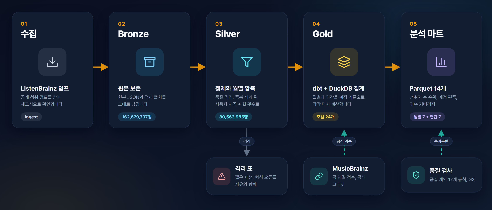
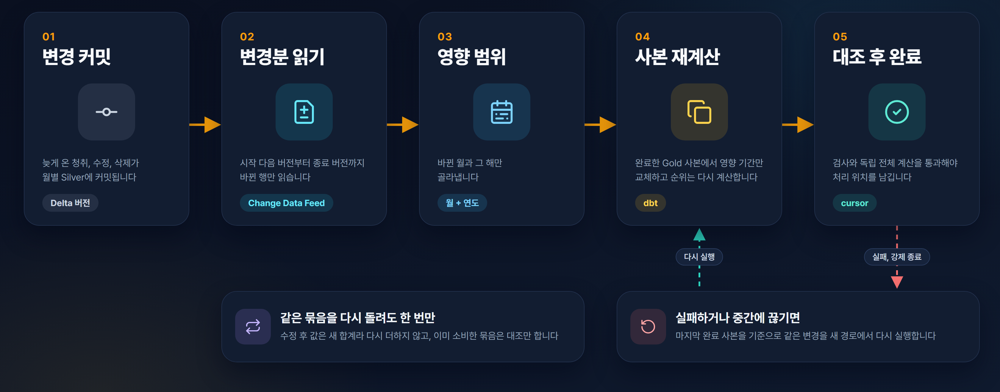

# 🎧 Flux

**1.6억 건의 음악 청취 기록을 정제하고, 반복 청취와 청취자 분포를 함께 분석하는 데이터 파이프라인입니다.**

ListenBrainz의 공개 청취 덤프와 MusicBrainz의 공식 메타데이터를 사용합니다. Spark와 Delta Lake로 원본을 보존하고 정제하며, dbt와 DuckDB로 월별과 연간 분석 마트를 만듭니다. 데이터가 바뀌었을 때의 재계산, 품질 검사, 실행 이력까지 같은 입력 버전을 기준으로 연결하는 것이 목표입니다.


| 검증한 입력 | 월별 Silver | 보존한 청취 횟수 | Gold 마트 |
| :--- | :--- | :--- | :--- |
| Bronze **162,679,797행** | **80,563,985행** | **157,351,363회** | 월별 7개 + 연간 7개 |

---

## 🎯 왜 만들었나

청취 수가 높다고 해서 많은 사람이 듣는 음악이라고 볼 수는 없습니다. 초기 분석에서 RM 청취의 약 58.2%가 한 계정에 몰린 사례를 찾았습니다. 반복 청취를 지우면 실제 청취 횟수를 잃고, 청취 수만으로 순위를 매기면 계정 편중을 놓칩니다. 그래서 반복은 `play_count`로 보존하고, 대표 순위는 고유 청취 계정 수로 정했습니다. [초기 비교 결과](docs/measurements/2026-10-18-artist-ranks.md)

같은 음악이 다른 이름이나 식별자로 들어오고 아티스트 연결에도 오류가 있습니다. 곡 연결과 공식 아티스트 귀속을 따로 관리하고, Live, Remix, Sped Up 같은 버전은 원곡에 합치지 않습니다. 확인하지 못한 연결은 보류하고 커버리지로 드러냅니다.

## 🧭 데이터 흐름



| 단계 | 하는 일 | 코드 |
| :--- | :--- | :--- |
| 수집 | 덤프를 내려받고 체크섬과 매니페스트로 확인합니다 | `src/flux/ingest/` |
| Bronze | 원본 JSON과 적재 출처를 Delta 표에 보존합니다 | `src/flux/bronze/` |
| Silver | 짧은 재생을 격리하고 동일 청취를 지운 뒤 사용자 + 곡 + 월 횟수로 압축합니다 | `src/flux/silver/` |
| Gold | 월별과 연간 마트를 dbt 모델로 계산합니다 | `dbt/flux_gold/` |
| 검사 | 품질 계약과 GX를 통과한 결과만 다음 기준으로 씁니다 | `src/flux/validation/` |

도착 시각이 아닌 청취 시각이 기준이라 늦게 들어온 기록이 과거 월을 바꿀 수 있습니다. 짧은 재생, 반복 청취, 버전 분리, 순위 계산 규칙은 [집계 정책](docs/aggregation_policy.md)에 모았습니다.

## 🔄 변경이 반영되는 흐름



전체를 매번 다시 계산하지 않습니다. Delta Change Data Feed로 바뀐 행만 읽고, 영향을 받은 월과 그 해만 다시 계산합니다. 순위와 계정 수는 기간 전체에서 다시 구하고, 연간 청취자 수는 월별 수를 더하지 않습니다.

| 단계 | 하는 일 | 코드 |
| :--- | :--- | :--- |
| 변경 내보내기 | 시작과 종료 버전을 고정해 CDF와 전후 월별 값을 내보냅니다 | `scripts/export_silver_cdf.py` |
| Gold 갱신 | 완료한 사본을 복사해 영향 기간만 교체합니다 | `scripts/update_gold_from_cdf.py` |
| 대조 | dbt 검사, 독립 전체 계산, 영향 밖 행 대조를 모두 통과해야 처리 위치를 남깁니다 | `src/flux/validation/gold_cdf.py` |

전체 Silver 사본에서도 통제한 변경 6행으로 Gold 14개가 전체 재계산과 일치하는 것을 확인했습니다. 운영 조회 경로를 자동으로 바꾸는 옵션은 없습니다.

## 📊 분석 마트

7개 마트를 월별과 연간으로 각각 만듭니다. 청취 수 순위도 비교용으로 남기고, 계정별 기여에서 최대 계정 비중, 집중도(HHI), 유효 청취자 수를 계산합니다.

| 마트 | 분석 단위와 주요 지표 |
| :--- | :--- |
| `song_metrics` | 곡별 청취 수, 청취자 수, 두 기준의 순위와 계정 편중 |
| `artist_metrics` | 공식 아티스트별 청취 수, 청취자 수와 계정 편중 |
| `artist_song_metrics` | 아티스트 안의 곡 순위, 곡별 청취 비중과 청취자 도달 비율 |
| `variant_metrics` | 버전 조합별 청취 수, 청취자 수와 비중 |
| `listener_metrics` | 가명화한 계정별 청취 수, 곡 키 수와 최다 청취 곡 비중 |
| `coverage` | 기간별 전체 청취와 공식 아티스트 귀속 범위 |
| `identity_coverage` | 곡 식별 검수 상태별 청취와 계정 수 |

공식 아티스트에 귀속된 청취는 현재 **약 16.26%**입니다. 아티스트 순위는 이 확인 범위의 결과입니다. [마트 정의와 조회 예시](docs/monthly_gold.md)

## ✅ 검증

| 검증 | 결과 |
| :--- | :--- |
| [dbt 전체 대조](docs/dbt_full.md) | 모델 24개, 데이터 검사 145개 실행. Gold 14개 모든 키와 값 일치, Parquet SHA-256 일치 |
| [품질 계약](docs/quality_contract.md)과 [GX](docs/gx_quality.md) | 17개 규칙에서 실패 0, 경고 2. 불량과 변조 결과의 전환 차단 확인 |
| [전체 규모 CDF 대조](docs/measurements/2026-10-23-full-silver-cdf-gold.md) | 통제 변경 6행 적용 뒤 Gold 14개가 전체 재계산과 일치 |
| [복원](docs/backup_restore.md) | Delta 4개 표와 이력, 처리 위치를 새 경로에 복원해 256개 월별 키 일치 |

검증 범위와 실행 기록, 데이터 카탈로그, CI 구성은 [검증과 실행 근거](docs/verification.md)에 있습니다.

## 📁 저장소 구조

```
flux/
├── src/flux/
│   ├── ingest/       덤프 수급, 체크섬, 매니페스트
│   ├── bronze/       원본 적재와 검증
│   ├── silver/       품질 격리, 중복 제거, 월별 압축, 곡 연결
│   ├── gold/         아티스트 귀속과 기간 집계
│   ├── validation/   품질 계약, GX, CDF 대조, 복원 검증
│   └── review/       곡 연결 검수 도구
├── dbt/flux_gold/    Gold 마트 dbt 모델
├── scripts/          파이프라인 실행, 실험, 장애 훈련
├── tests/            pytest (Spark, dbt, GX 검사는 마커로 분리)
├── airflow/          Airflow 스모크 DAG
├── explorer/         표본 탐색용 Streamlit 화면
└── docs/             설계, 정책, 검증 기록
```

## 🚀 시작하기

원본 덤프와 생성 데이터는 저장소에 넣지 않습니다. 코드 검사는 데이터 없이 돌릴 수 있습니다. 저장소 루트에서 Python 3.14 기준으로 실행합니다.

```powershell
python -m venv .venv
.venv/Scripts/python -m pip install -r requirements-dev.txt
.venv/Scripts/python -m pytest -q
```

기본 명령은 Spark, 클러스터, dbt, GX 검사를 제외합니다. dbt와 GX는 Python 3.11 전용 환경으로 분리했습니다.

| 하려는 일 | 안내 |
| :--- | :--- |
| 실제 엔진 검사 | [docs/ci.md](docs/ci.md) |
| 덤프 수급과 Spark 실행 | [docs/running.md](docs/running.md) |
| 월별 Silver 만들기 | [docs/user_recording_counts.md](docs/user_recording_counts.md#월별-silver-전환) |
| Gold 전체 실행 | [docs/dbt_full.md](docs/dbt_full.md#재현) |

## 🧱 해석 범위와 다음 작업

ListenBrainz 참여 계정의 기록이라 전체 음악 시장이나 팬덤 규모로 일반화하지 않습니다. 청취자 수는 고유 계정 수이고, 한 사람의 여러 계정은 구별하지 못합니다. MSID가 다른 동일 청취의 추가 중복 제거와 미확정 곡 연결, 아티스트 귀속은 후속 검수 대상입니다. 월별 Silver만으로 개별 청취 시각이나 정확한 일별, 주별 청취자 수는 복원할 수 없습니다.

배치 수집과 CDF 기반 사본 갱신까지 검증했습니다. 실시간 수집, Airflow 전체 통합, PostgreSQL과 FastAPI 서빙, 새 덤프의 연속 운영은 다음 범위입니다. [현재 상태](docs/status.md), [확장 계획](docs/data_governance_plan.md)
