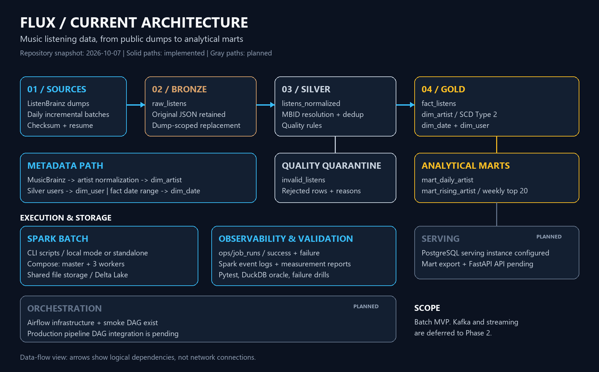

# Flux

**1.6억 건의 음악 청취 로그를 정제하고, 사용자별 월간 청취 횟수와 아티스트 지표를 만드는 배치 데이터 파이프라인.**

ListenBrainz의 실제 청취 기록과 MusicBrainz의 아티스트 메타데이터를 Spark로 처리합니다. Delta Lake에 원본과 정제 결과를 보존하고, 아티스트 개명 이력까지 반영한 분석 마트를 만듭니다.

| 처리 규모 | 데이터 모델 | 실행 환경 | 현재 범위 |
|---|---|---|---|
| 통합 Bronze **162,679,797행** | Delta Lake, SCD Type 2 | 로컬 / Spark standalone 실험 | 통합 입력의 월별 Silver와 월별/연간 Gold 스냅샷 검증 |

[현재 상태와 남은 작업](docs/status.md) / [아키텍처](#architecture) / [진행 상황](#진행-상황) / [실측](#실측) / [검증](#검증) / [실행 안내](docs/running.md)

> 기존 마트 설명은 2026-10-07 코드 기준이며, 아래 현황은 2026-10-22까지 반영했습니다. PostgreSQL 서빙 적재와 FastAPI, Airflow 통합은 후속 작업입니다.

현재 보완은 세 갈래입니다. Silver에서 확인된 재생 시간이 30초 미만인 기록을 격리하고, 반복 청취는 사용자와 MSID별 play_count로 보존합니다. Gold의 새 마트는 청취 수와 청취자 수를 함께 계산하고 청취자 수로 순위를 매깁니다. 같은 곡이 다른 MSID로 등록된 경우는 별도 후보 조사와 검토를 거쳐 연결합니다. [상세 정책과 검증 범위](docs/user_recording_counts.md)를 참고하세요.

30초 정책과 사용자별 증분 집계는 코드에 반영했습니다. 10월 1일과 18일 덤프의 실험 사본에서 증분 반영과 각 재실행을 검증하고, 네 단계의 고정 버전 전체 키를 DuckDB로 대조해 모두 일치했습니다. 운영 경로는 변경하지 않았습니다. 이후 별도 경로의 30초 소급 정제와 월별 전환까지 완료했으며, 아래 최신 결과와 입력 범위를 구분합니다. [실험 절차와 결과](docs/increment_verification.md)를 참고하세요.

이전 상세 모델의 [예비 순위 비교](docs/measurements/2026-10-18-artist-ranks.md)는 반복 청취와 고유 청취자 수의 차이를 확인한 실험입니다. 이후 공식 크레딧 검사와 입력 범위가 달라졌으므로 그때의 연결률과 순위를 현재 Gold의 값으로 사용하지 않습니다. 최신 귀속률과 검증 범위는 아래 연결 정책을 따릅니다.

[일별과 주별 청취자 순위 마트](docs/artist_periods.md)를 추가했습니다. 청취 수와 고유 청취자 수, 한 계정의 최대 청취 수 및 비중과 기간별 커버리지를 함께 계산합니다. 30초 기준 Silver와 종속 집계, 새 Gold 마트를 별도 경로에서 전체 생성하고 독립 검증 10개 묶음을 통과했습니다. 운영 경로는 교체하지 않았습니다. [전체 재생성 결과](docs/rebuild_30seconds.md)에 수치와 검증 범위를 기록했습니다. 이후 추가 두 덤프까지 포함한 Bronze 162,679,797건에서 Silver 상세 157,351,363건과 사용자+MSID 집계 44,261,553행의 전수 검증을 완료했습니다. 이후 추가분을 포함한 월별 및 연간 Gold 스냅샷도 별도로 생성했으며 기존 Gold와 입력 및 모델을 구분합니다.

월별 Silver도 별도 경로에서 생성하고 독립 전수 대조를 완료했습니다. 사용자 이름+MSID+UTC 청취 월 기준 **80,563,985행**에 총 **157,351,363회**를 보존합니다. 메타데이터 사전과 격리를 포함한 활성 파일은 **5.15GB**로 기존 상세+전체 기간 횟수+격리 15.54GB보다 **66.9% 감소**했습니다. 새 출력에는 개별 청취 상세를 추가 저장하지 않습니다. 전체 키 불일치 0건과 실제 동일 입력 재실행의 무변경을 확인했습니다. 기존 검증본은 보관하며 [월별 및 연간 Gold](docs/monthly_gold.md) 14개 마트를 별도 스냅샷으로 생성하고 검수했습니다. [실행 및 검증 결과](docs/rebuild_30seconds.md#월별-delta-실제-생성)를 참고하세요.

---

[월별 및 연간 Gold 최초 실측](docs/measurements/2026-10-19-monthly-gold.md): 청취 수와 청취자 수, 동률 순위, 최대 계정 비중과 집중도, 아티스트 내 곡 비중 및 버전 분리를 제공합니다. 이후 곡 버전 판정과 아티스트 귀속을 분리하고 옛 MBID를 연결해 전체 귀속률을 **13.54%에서 16.26%**, 2026년 8월은 **21.83%에서 24.57%**로 높였습니다. 추가 **4,280,281회**를 공식 아티스트에게 귀속했고 전체 **157,351,363회**는 보존합니다. Sped Up과 Remix의 곡 키 및 버전별 집계는 그대로 유지합니다. [연결 정책과 실제 사례](docs/measurements/2026-10-19-artist-attribution.md)를 참고하세요. 미확정 청취도 곡과 계정 마트에 남으며 아티스트 순위는 확인된 범위만 나타냅니다.

곡 연결은 [근거와 검수 이력](docs/recording_review.md)을 따로 저장합니다. 실제 102행에서 후보 51쌍을 검수하고 확인 범위만 별도 월별 사본에 적용해, 138행에서 137행으로 줄이면서 245회를 보존했습니다. 이 결과는 agent의 실험용 판단이며 사람 승인과 전수 적용 및 운영 데이터 반영은 아직 수행하지 않았습니다. [표본 결과와 한계](docs/measurements/2026-10-22-recording-review.md)를 참고하세요.

이후 작업은 [모델링과 품질 및 CDF 확장 계획](docs/data_governance_plan.md)을 따릅니다. 기존 Spark 정제와 월별 집계 및 검수 이력은 유지하고, CDF 증분 검증 뒤 Gold SQL의 dbt 이전, 실행 품질 검사와 데이터 카탈로그 연결을 단계적으로 진행할 계획입니다. 아직 새 도구 설치나 운영 데이터 변경은 하지 않았습니다.

[P0 비교 기준](docs/measurements/2026-10-22-governance-baseline.md)은 고정 버전에서 6,469행과 113,368회의 작은 입력을 만들고 14개 마트를 독립 검증했습니다. 기존 전체 Gold의 곡 결과 1,767행도 대조했으며 원래 전체 순위는 별도 참조로 보존합니다. 원본 없이 재검증할 수 있고 새 연속 입력 확보 및 dbt와 GX 호환성 확인은 후속입니다.

[P1 품질 계약](docs/quality_contract.md)은 실패와 경고 및 적용 제외를 구분한 17개 규칙입니다. 고정 표본은 실패 0, 경고 2, 적용 제외 1이며, 메모리 사본의 오류 주입 16개가 모두 기대대로 검출됐습니다. 관련 회귀 테스트 180개를 통과했고 운영 데이터는 변경하지 않았습니다. [검증 범위와 남은 경고](docs/measurements/2026-10-22-quality-contract.md)를 따릅니다.

[P2 CDF 사본 검증](docs/measurements/2026-10-22-monthly-cdf.md)은 보관한 두 덤프의 작은 실제 표본에서 재적재와 수정, 삭제 및 프로세스 종료 복구를 확인했습니다. 14개 시점의 고정 버전 전체 대조 불일치 0, 호스트 관련 테스트 189개와 Spark 6개가 통과했습니다. 운영 데이터와 CDF 설정은 유지했으며 새 덤프 전체의 성능 및 연속 운영은 후속입니다.

[dbt 첫 이전](docs/dbt_pilot.md)은 고정 표본의 월별 곡과 커버리지부터 별도 DuckDB에서 실행했습니다. 곡 마트 1,445행과 커버리지 255행, 총 113,368회가 기존 결과 및 Python 독립 계산과 일치했습니다. 7개 모델과 데이터 테스트 37개, 재실행 및 오류 주입 5개를 검증하고 모델 문서를 생성했습니다. 운영 데이터와 나머지 마트는 유지하며 [검증 범위](docs/measurements/2026-10-22-dbt-pilot.md)를 구분합니다.

## Overview

Flux는 '변화', '흐름'을 의미하는 라틴어 Fluxus에서 유래했습니다.

MetaBrainz의 ListenBrainz에서 발생한 음악 청취 로그를 수집, 가공하여 수집한 ListenBrainz 표본의 음악 청취 흐름, 시기별 트렌드, 아티스트 메타데이터 연계 분석을 수행하는 배치 데이터 파이프라인입니다.

현재 결과물은 Delta Lake의 Bronze와 월별 Silver, 별도 Parquet 기반 Gold 스냅샷입니다. 기존 Delta Gold 구현 이력도 보존합니다. 우선 증분 처리의 정확성을 검증하고 청취자 수를 기준으로 수집 표본의 흐름을 분석합니다. PostgreSQL과 FastAPI 조회 제공, 음악 트렌드 리포트와 추천 시스템 입력은 이후 확장 목표입니다.

---

## Architecture

청취 덤프는 **Bronze → Silver → Gold**로 흐릅니다. MusicBrainz 메타데이터는 별도 정제 경로로 아티스트 차원에 연결합니다. Silver에서 거절한 행은 격리 테이블에 보존합니다. 그림 아래의 실행 환경과 운영 기록은 이 데이터 흐름을 지원하는 구성입니다.

**구현과 기동을 구분합니다.** Spark 배치 잡과 Delta 마트는 구현됐습니다. Docker Compose에 PostgreSQL과 Airflow 구성은 있지만, 서빙 적재와 조회 API는 아직 없고 Airflow DAG도 스모크 검증 단계입니다. 회색 영역은 이 후속 연결을 나타냅니다.

새 Silver는 사용자 이름+MSID+UTC 청취 월별 횟수와 곡 메타데이터 사전, 격리 표를 별도 경로에 만듭니다. 아래 상세 기반 Silver와 Gold는 기존 구현 이력이며 월별 출력은 공식 크레딧 대조를 거쳐 DuckDB로 별도 Gold 스냅샷을 생성합니다. [월별 규칙](docs/user_recording_counts.md#월별-silver-전환)과 [전용 실행 안내](docs/running.md#월별-silver-전용-경로)를 참고하세요.

그림의 근거와 수정 방법은 [아키텍처 설명](docs/architecture.md)에 있습니다.

Delta Lake 기반 [Medallion Architecture](https://learn.microsoft.com/ko-kr/azure/databricks/lakehouse/medallion)로 3단계 정제 레이어를 둡니다.

| 레이어 | 테이블 | 내용 |
|---|---|---|
| **Bronze** | `raw_listens` | 원본 JSON 보존. 덤프 단위 `replaceWhere`로 멱등 적재 |
| **Silver (월별)** | `monthly_user_recordings` | 사용자 이름과 MSID 및 UTC 청취 월별 play_count. 개별 청취 상세를 추가 저장하지 않음 |
| | `recording_metadata` | MSID별 관측 곡 메타데이터 변형의 고유 조합. 유일 대표값은 별도 판단 |
| **Silver (기존 상세)** | `listens_normalized` | MBID 해석, 중복 제거와 품질 격리를 검증한 이전 상세 입력. 새 월별 출력에는 복제하지 않음 |
| | `user_recording_counts` | 기존 사용자 ID+MSID 전체 기간 횟수. 월별 전환에서 대체하며 이전 검증본은 보존 |
| | `invalid_listens` | 품질 규칙 위반 격리 테이블 |
| **Gold (월별 및 연간)** | 곡, 아티스트, 아티스트 내 곡, 버전, 계정과 커버리지 | 확인 범위와 미확정 상태를 구분한 Parquet 스냅샷 14개. DuckDB 뷰로 조회 |
| **Gold (기존 상세)** | `dim_artist` | 아티스트 차원. SCD Type 2로 개명 이력 보존 |
| | `dim_date` | UTC 날짜와 ISO 주 기준을 공통으로 제공 |
| | `dim_user` | 사용자 번호별 최신 이름과 청취 기간, 청취 수 |
| | `fact_listens` | 청취 팩트. 청취 하나와 아티스트 하나의 쌍이 한 행인 스타 스키마 |
| | `mart_daily_artist` | 일별 아티스트 청취 집계. 그날 유효했던 이름을 시점 조인으로 붙인다 |
| | `mart_rising_artist` | ISO 주별 급상승 상위 20. 지난주 청취 20회 이상인 아티스트의 증가 비율로 순위 산정 |

기존 상세 기반 Silver 청취 테이블, Gold 팩트와 일별 마트의 파티션은 `listened_month`입니다. 명세는 `listened_date`였으나 청취 날짜가 7,877개로 흩어져 조각의 99.5%가 10만 행 미만이 되는 것을 실측하고 달 단위로 바꿨습니다.

---

## 진행 상황

아래 S0-S6는 기존 상세 모델의 구현 이력입니다. 최신 월별 Silver와 월별 및 연간 Gold 스냅샷은 검증 완료했습니다. 곡 연결과 사건 중복 및 아티스트 귀속 범위의 확장 검수는 계속 남아 있습니다. [후속 작업의 선행 조건](docs/status.md)을 따릅니다.

| 단계 | 내용 | 상태 |
|---|---|:-:|
| S0 | 개발 환경 (Docker Compose, Spark 클러스터, Airflow, PostgreSQL) | 완료 |
| S1 | 덤프 수급 (체크섬 검증, 이어받기, 매니페스트) | 완료 |
| S2 | Bronze 적재 | 완료 |
| S3 | Silver 정제와 SCD Type 2 | 완료 |
| S4 | Gold 차원과 일별 마트, 주간 급상승 마트, 스큐 실험 | 완료 |
| S5 | PostgreSQL 서빙과 FastAPI | 예정 |
| S6 | 잡 실행 기록 구현. Airflow 파이프라인 통합과 운영 마감 | 진행 중 |

---

## 실측

아래 수치는 해당 측정 시점의 데이터 스냅샷입니다. 최신 잡 실행 결과와 구분해 읽습니다.

2026-08-08 ~ 09-07 증분 덤프 31일치 기준입니다.

| 항목 | 값 |
|---|---:|
| Bronze 적재 | 155,713,649행 |
| Silver 정제 | 151,192,624행 |
| 중복 제거 | 4,521,025행 (2.90%) |
| 품질 격리 | 0행 |
| `dim_artist` | 2,976,554 아티스트 + placeholder 661 |
| `fact_listens` | 151,800,271행 (청취당 아티스트 1.0040) |
| `mart_daily_artist` | 14,792,567행 |
| 파티션 (달) | 260개 |

중복 제거로 지워진 행 중 MBID 보유는 36.26%지만 그 99.6%가 `LASTFM` 출처이고, ListenBrainz가 직접 해석한 `MAPPING` 출처는 한 건도 지워지지 않았습니다. 정렬의 첫 키가 출처 순위이므로 남은 행이 언제나 그 그룹에서 가장 좋은 출처를 갖습니다.

청취에 실제로 쓰인 아티스트는 311,929명으로 차원의 10.5%이며, 그중 661명(0.21%)이 차원에 없어 placeholder로 처리합니다. 청취 기록과 MusicBrainz 덤프의 시점이 다르기 때문입니다.

### S4 실험

로컬은 `local[*]` 20코어, 클러스터는 standalone 워커 3개(실행기당 2코어 1g)입니다. 수치는 Spark 이벤트 로그에서 꺼냈고, 실험마다 최종 물리 계획을 함께 남깁니다.

| 실험 | 결과 | 문서 |
|---|---|---|
| AQE off / on / Salting / 둘 다 (조인, 로컬과 클러스터 각 12런) | BTS 한 아티스트의 파티션이 행으로 중앙의 11.25배지만, 그 태스크(2.2초)가 조인 단계(4.9초)보다 짧아 시간을 잡아먹지 않았습니다. AQE는 스큐 조인을 한 번도 하지 않았고(압축된 바이트로는 1.74배라 판정 조건 미달) 파티션만 합쳤습니다. Salting은 편중을 1.38배로 없앴지만 차원 16배 복제로 조인 단계가 두 배가 됐습니다 | [skew-cluster](docs/measurements/2026-10-02-skew-cluster.md) |
| 셔플 파티션 수 24 / 48 / 96 / 192 | 파티션이 적을수록 최장/중앙은 작아지고(행 2.27에서 11.43, 실행 전 계산과 일치), 가장 긴 태스크는 2.7초에서 8.2초로 길어져 단계 끝을 붙잡습니다 | [partitions](docs/measurements/2026-10-02-partitions.md) |
| broadcast / shuffle / 차원 선필터 | 시간은 같았습니다(12.0~12.9초). broadcast는 셔플 496MB를 없애고 저장 메모리 948MB, shuffle은 정렬에 2.06GB, 쓰이는 키로 차원을 먼저 거르면 셔플 94MB와 메모리 0.57GB로 가장 가볍습니다 | [broadcast](docs/measurements/2026-10-02-broadcast.md) |
| 워커 1개 강제 종료 (클러스터) | 첫 셔플이 끝난 뒤 워커를 죽였습니다. 잃은 맵 출력 569개 중 190개만 다시 만들었고 결과 네 값이 기준선과 일치했습니다. 소요 1.49배 | [worker-kill](docs/measurements/2026-10-02-worker-kill.md) |
| Z-Order, OPTIMIZE, 압축 코덱 | Z-Order로 마트 612.7MB가 112.6MB(5.4배), 필터 조회 3.2배. 주된 이유는 정렬이 Parquet 압축을 살린 것입니다. OPTIMIZE 단독은 효과가 없었고 zstd가 snappy보다 48% 작았습니다 | [delta-layout](docs/measurements/2026-09-19-delta-layout.md) |
| Delta MERGE 대 Parquet 재작성 (SCD2) | 1명 갱신에 쓰기 21.5배 감소. 바뀌는 아티스트가 100명부터는 이득이 사라집니다 | [merge-vs-parquet](docs/measurements/2026-09-19-merge-vs-parquet.md) |

---

## 검증

각 단계마다 통과해야 할 게이트를 정하고 실패를 주입해 확인합니다.

- **ACID**: Bronze 적재 도중 컨테이너를 강제 종료해 고아 parquet 44개가 읽히지 않는 것을 확인
- **SCD2 불변식**: 현재 줄이 정확히 1개, 현재 줄이 없는 아티스트 0건, 유효 구간이 뒤집힌 줄 0건. 297만 행 전수
- **개명 시나리오**: 아티스트 개명을 주입해 이력 2행이 생기는 것을 확인하고 시점 조회로 복원
- **MERGE 원자성**: 병합 도중 강제 종료. 2단계 MERGE는 반쪽 상태를 남겨 **게이트를 통과하지 못했고**, 한 문장으로 합쳐 다시 확인
- **결정성**: 입력 순서를 순열로 바꿔도 중복 제거 결과가 같은 것을 확인
- **교차 대조**: `groupBy`와 윈도우 함수 두 경로로 센 중복 제거 결과가 일치
- **정합성 오라클**: Spark가 만든 마트를 DuckDB로 한 주 다시 세어 7일 전부 일치
- **시점 조인**: 개명을 주입하고 개명 전 청취는 옛 이름, 뒤 청취는 새 이름으로 조회되는 것을 확인
- **워커 강제 종료**: 클러스터에서 셔플 도중 워커를 죽이고, 이벤트 로그로 재계산을 확인한 뒤 결과를 기준선과 대조
- **격리 주입**: 31일치에서 격리가 0건이라 격리 경로가 실제로 도는지 따로 확인. 하루치 사본에 품질 규칙마다 걸리는 불량 4행을 넣어 4행 모두 기대한 사유로 격리되고, Silver에는 없고, 원본 JSON이 그대로인 것을 확인
- **점검은 사본에서**: 차원 점검(개명, 시점 조인, 이름 채우기)과 격리 점검 모두 운영 테이블을 임시 사본으로 복사해 거기서 바꾸고 지운다. 운영 테이블을 바꿨다가 Delta 시점 조회로 되돌리던 방식은 보존 기간(7일)이 지나면 되돌리기가 막혀 운영 테이블이 바뀐 채 남았다

테스트는 두 층입니다.

| 층 | 개수 | 어디서 | 무엇을 |
|---|---:|---|---|
| 판단 | 581 | 호스트, 3초 | 무엇이 바뀌면 새 버전인가, 어느 줄을 남기는가 |
| 번역 | 60 | 컨테이너, `-m spark` | 판단 모듈과 Spark 잡이 같은 규칙을 쓰는가 |

판단이 Spark 없이 도는 것은 그것을 pyspark를 부르지 않는 모듈로 분리했기 때문입니다.

번역 층을 따로 둔 이유는 **실제로 터진 버그가 전부 그 사이에서 났기** 때문입니다. `_record_id` 하나를 식별자로 써서 부풀림 16배, `explode`로 9,119만 행 소실, 2단계 MERGE의 반쪽 상태. 판단이 틀린 적은 없고, 셋 다 1.5억 행 잡을 돌려야 보였습니다. 수십 행 픽스처로 같은 것을 봅니다.

번역 층은 호스트에서 돌지 않습니다. Spark 4.x가 JDK 17+를 요구하고 호스트에는 없어 건너뛰기로 처리되며, `flux-spark` 이미지 안에서만 돕니다.

번역 층 60개에 **4분 15초**가 걸립니다(2026-10-02. 9월에는 54개에 4분 29초 ~ 6분 09초, 4회 실측). 병목은 JVM 기동(38초, 1회)이 아니라 Delta입니다 — 차원을 만들고 `MERGE`하는 Gold 테스트가 수십 행에도 각 13~22초입니다. 판단 층이 3초인 이유가 여기서 드러납니다. 판단을 pyspark 밖으로 뺀 것이 100배의 차이입니다.

실행 방법은 [docs/running.md](docs/running.md)에 있습니다.

---

## Tech

**구현됨**

- Delta Lake 기반 Medallion Architecture (Bronze, Silver, Gold)
- Spark Batch로 덤프 적재와 MusicBrainz 메타데이터 조인
- Delta Lake `MERGE INTO`로 SCD Type 2 이력 관리. 닫기와 열기를 한 문장으로 처리해 원자성 확보
- 시점 범위 조인으로 과거 청취를 당시 아티스트 이름에 연결
- Delta Lake time travel을 실험 후 복원과 백필 검증에 활용
- AQE와 Salting 4단계 스큐 비교 실험을 로컬과 Spark standalone 클러스터에서 실측
- Spark 이벤트 로그에서 태스크별 시간과 읽은 행 수, 셔플, 실행기 메모리, 최종 물리 계획을 수집
- 워커 강제 종료로 계보 기반 재계산과 결과 정합성 확인

**예정**

- PostgreSQL 서빙 마트와 FastAPI 기반 조회 API
- Airflow DAG 통합

**Phase 2 (MVP 범위 밖)**

- Kafka 기반 이벤트 수집. 정적 덤프 재생에는 명분이 약해 실시간 API 연동 시점으로 미룸
- Spark Structured Streaming 적재

---

## 시작하기

데이터 경로 설정, 이미지 빌드, Spark 잡과 테스트 실행은 [실행 안내](docs/running.md)를 따릅니다. 데이터는 저장소 밖에 두며 원본 덤프와 Delta 테이블은 Git에 포함하지 않습니다.

## 더 읽기

| 문서 | 내용 |
|---|---|
| [현재 아키텍처](docs/architecture.md) | 데이터 의존 관계, 실행 환경, 구현 상태와 그림 재생성 |
| [실행 안내](docs/running.md) | 컨테이너와 마운트, 잡 실행, 테스트 |
| [MBID 해석](docs/mbid_resolution.md) | 아티스트 식별자의 출처 우선순위 |
| [중복 제거](docs/deduplication.md) | 동일 청취에서 남길 행의 결정 규칙 |
| [파티션 설계](docs/partitioning.md) | 월 단위 파티션을 선택한 근거 |
| [보존 정책](docs/retention.md) | Delta 로그와 파일의 보존 |
| [실측 기록](docs/measurements/) | 최적화와 장애 실험의 결과 및 재현 근거 |
