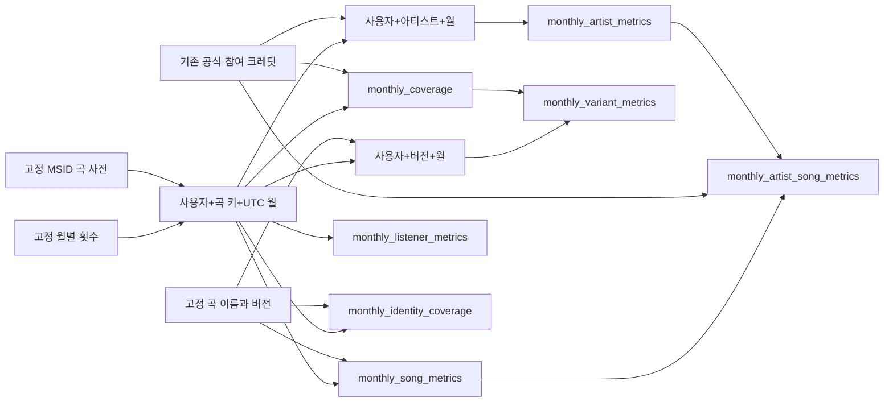

# 월별 및 연간 Gold 14개 마트의 dbt 이전

## 범위와 입력 경계

P3는 월별 곡과 커버리지부터 시작했고 월별 아티스트, 아티스트 내 곡, 버전, 계정 및 곡 식별 커버리지까지 확대했다. 이어 같은 지표의 연간 7개를 추가해 총 14개 최종 마트를 고정 표본에서 검증했다. [P0 고정 표본](measurements/2026-10-22-governance-baseline.md)의 월별 횟수와 곡 사전, 라벨 및 공식 크레딧을 별도 DuckDB에 복사한다. source_context와 처리 버전, UTC 및 30초 정책, user_name 계정 키와 R9의 참조 전용 범위를 확인한 뒤에만 시작한다. 사람 승인 0건과 빈 R9 매핑인 현재 표본의 범위만 허용한다.

dbt는 이 로컬 DB의 pinned 스키마만 source로 읽는다. 운영 Delta의 파일 선택과 곡 검수 및 CDF 처리는 기존 코드가 담당한다. 이번 이전은 월별 Silver의 play_count와 곡 연결, 버전 또는 아티스트 귀속 규칙을 바꾸지 않는다. MBID 없는 곡과 아티스트 미연결 청취도 기존 정책대로 보존한다.

## 모델 구조

[dbt 프로젝트](../dbt/flux_gold/dbt_project.yml)는 고정 입력을 노출하는 staging 뷰 4개, 사용자별 월간 및 연간 곡과 아티스트 및 버전 뷰 6개와 최종 테이블 14개로 구성한다. 총 모델은 24개다. ref와 source로 관계를 선언하고 dbt가 실행 순서와 모델 계보를 만든다. 그림은 월별 하위 구조를 표시하며 staging 뷰를 입력에 묶었다. 연간 마트는 아래의 사용자별 연간 기여에서 별도로 계산한다.



한 계정의 여러 MSID가 같은 고정 곡 키를 가리키면 횟수를 먼저 합친다. 그 뒤 계정 수를 세어 중복 청취자를 만들지 않는다. 청취 수, 고유 계정 수, 최대 계정 횟수와 비중, 계정당 평균 및 집중도는 기존 공식을 따른다. listener_rank는 청취자 수 기준 rank이며 동률은 1, 1, 3이다. 이름순 표시는 조회에서 `order by period_start, listener_rank, song_name, song_key`를 사용한다. 테이블의 물리 저장 순서를 표시 순서로 간주하지 않는다.

커버리지는 크레딧이 하나 이상 있는 곡인지를 판정한다. 공동 참여 아티스트가 여러 명이어도 해당 청취의 linked_listens는 한 번만 포함한다. 전체 청취와 전체 고유 계정을 분모에 보존한다. 곡 버전은 기존 라벨을 그대로 유지하며 Live, Remix와 Sped Up을 합치지 않는다.

아티스트 집계에서는 공식 참여자마다 전체 곡 횟수를 부여하고, 같은 아티스트의 여러 곡을 들은 계정은 먼저 합산한다. 따라서 아티스트별 횟수 합은 전체 청취 수와 같아야 하는 지표가 아니다. 아티스트 내 곡 비중은 해당 아티스트의 월간 청취 수를 분모로 하고, 곡 청취자 도달률은 해당 아티스트의 고유 계정 수를 분모로 한다. 한 계정이 여러 곡을 들을 수 있어 도달률의 합은 1을 넘을 수 있다. 아티스트와 아티스트 내 곡도 청취자 수 기준 공동 순위이며 표시할 때 이름순을 명시한다.

버전 지표도 계정별 여러 곡을 먼저 합친다. 미연결 청취를 포함한 전체 월간 청취와 계정 수가 분모다. 계정 마트는 원래 user_name의 SHA-256 키를 유지하며 월별 고유 곡 수와 최다 곡 비중을 제공한다. 이는 결정적 가명화이며 익명성 보장을 뜻하지 않는다. 식별 커버리지는 곡의 identity_status 기준이며 아티스트 귀속 승인과 별개다. 상태별 및 버전별 청취자 수를 더해 전체 청취자 수를 만들지 않는다.

## 연간 기여와 지표

int_user_yearly_songs는 int_user_monthly_songs의 사용자 이름+곡 키+UTC 청취 월을 사용자 이름+곡 키+UTC 연도로 다시 묶는다. 이 입력은 계정 정보가 남은 기여 표다. 월별 곡 마트의 listeners나 최대값 및 비중을 합치는 방식이 아니다. 같은 계정이 여러 달에 등장해도 연간 한 번 세고, 모든 달의 횟수를 더한 계정별 기여에서 최대값과 비중 및 집중도를 구한다. 아티스트와 버전도 연간 사용자별 기여를 먼저 합친다.

yearly_song_metrics, yearly_artist_metrics, yearly_artist_song_metrics, yearly_variant_metrics, yearly_listener_metrics, yearly_coverage와 yearly_identity_coverage가 최종 연간 표다. 연간 곡 수는 같은 곡을 여러 달 들었어도 계정당 한 번 센다. 연간 커버리지의 전체 및 연결 계정 수도 해당 연도의 사용자 집합에서 다시 센다. 날짜 키는 UTC 청취 연도의 1월 1일이며 다음 해의 기여는 분리한다. 참여 아티스트 귀속과 미연결 보존 및 버전과 공동 순위 정책은 월별과 같다.

## 검사와 완료 조건

[P1 품질 계약](quality_contract.md) 중 이번 모델 범위의 키와 양의 정수 횟수, 참조, 보존 합계와 지표 범위, 공동 순위 및 버전 라벨을 dbt 데이터 테스트로 실행한다. 중복 실행 담당은 현재 파일럿으로 제한하며 모든 P1 규칙이 dbt로 이전됐다고 표시하지 않는다. 원문 30초 판정과 격리 및 수집 경고는 기존 경계에 남는다. 월별 표에 없는 재생 시간을 추정하지 않는다.

실행기는 먼저 dbt debug로 연결을 확인한다. dbt build의 모든 모델과 검사 노드가 성공해야 다음 단계로 간다. 모델 및 테스트가 일부 성공해도 전체 성공으로 취급하지 않는다. 같은 입력으로 다시 build한 뒤 기존 기대값과 대조하고 docs generate를 실행한다. [dbt build의 동작](https://docs.getdbt.com/reference/commands/build)과 [문서 산출물](https://docs.getdbt.com/reference/commands/cmd-docs)을 따른다.

월별 및 연간 최종 표 14개는 각각의 기간으로 보관된 P0 기대값, 기존 Python 내부 SQL 생성기와 Python 독립 집계에 각각 대조한다. 모든 키와 열, 자료형, 정수와 NULL 상태를 비교하고 실수는 상대 및 절대 허용 오차 1e-12로 검사한다. 원래 전체 Gold 순위와 작은 표본의 순위는 구분한다. source 테이블과 복사한 입력, 원래 고정 자료 및 실행 SQL 프로젝트도 변경되지 않아야 한다. 전부 통과한 뒤에만 새 결과의 completed를 true로 기록한다. 이 파일럿의 promotion_ready는 false다.

dbt 데이터 테스트 145개는 키와 횟수, 참조, 순위 및 지표와 보존 합계를 검사한다. 월별 및 연간 아티스트, 아티스트 내 곡, 버전, 계정과 식별 상태에는 입력의 기여를 대조하는 SQL 검사도 있다. 연간 사용자별 기여는 고정 월별 원천과 곡 사전에서 직접 계산한 값에 양방향 대조한다. 곡과 커버리지, 버전, 계정 및 식별 상태의 월별 및 연간 횟수 합을 입력과 대조하지만 아티스트별 합에는 전체 보존식을 강제하지 않는다. 정상 DB의 별도 사본 17개에서 중복과 0회 및 사전 누락, 순위와 커버리지 및 연간 마트 오류를 주입한다. 연간 곡 및 전체 계정 수를 월별 고유 수의 합으로 바꾸는 오류도 검사한다. 기대 데이터 테스트의 fail과 종료 코드 1을 요구하고 SQL 실행 error를 오류 검출 성공으로 인정하지 않는다.

## 분리 환경과 재현

기존 Python 3.14와 Spark 환경은 유지하고 호스트의 Python 3.11.9로 별도 환경을 만들었다. 실제 검증 조합은 dbt-core 1.11.16, dbt-duckdb 1.11.0 및 기존과 같은 DuckDB 1.5.5다. [어댑터의 배포 정보](https://pypi.org/project/dbt-duckdb/)를 확인한 뒤 모델과 검사 및 문서 생성까지 실행했다. Python 3.14나 dbt v2의 호환성을 이 실험으로 판단하지 않는다.

직접 의존성은 requirements-dbt.in, 실제 분리 환경의 58개 배포 버전은 requirements-dbt.txt에 고정했다. Git Bash에서 새 출력 이름으로 실행한다. 전역 profiles.yml을 바꾸지 않고 프로젝트의 로컬 프로파일과 환경 변수를 사용한다. 익명 사용 통계는 끄고 DuckDB는 내부 표만 읽도록 설정했다. 자원 설정은 스레드 2개와 DuckDB 메모리 2GB다.

```bash
py -3.11 -m venv data/dbt-runtime
uv pip install --python data/dbt-runtime/Scripts/python.exe -r requirements-dbt.txt

PYTHONPATH=src data/dbt-runtime/Scripts/python scripts/build_dbt_pilot.py \
  --baseline data/governance-baseline-20261022-r2 \
  --output data/dbt-pilot-new

PYTHONPATH=src data/dbt-runtime/Scripts/python scripts/drills/dbt_marts.py \
  --root data/dbt-pilot-new

data/dbt-runtime/Scripts/python -m pytest tests/test_dbt_runtime.py -m dbt -q

venv/Scripts/python -m pytest tests/test_dbt_pilot.py -q
```

결과는 새 출력의 pilot.duckdb에 저장한다. project는 실행한 SQL 및 YAML 복사본이고 target-build와 target-rebuild에는 각 실행의 manifest.json 및 run_results.json이 남는다. target-docs에는 index.html과 manifest.json 및 catalog.json이 생성된다. 생성 경로는 명령 인자로 프로젝트 밖에 지정한다. 원문이나 DuckDB 및 생성 문서는 Git에 포함하지 않는다.

생성한 문서를 보려면 해당 폴더만 로컬로 제공할 수 있다. 이번 검증은 문서 파일과 열 설명 및 모델 의존 관계의 산출물을 확인했으며 브라우저 화면 렌더링 검수는 포함하지 않았다.

```bash
venv/Scripts/python -m http.server 8088 --bind 127.0.0.1 \
  --directory data/dbt-pilot-new/target-docs
```

## 남은 검증과 운영 확장

월별 및 연간 14개 마트의 고정 표본 이전을 완료했다. 기존 전체 14개 Parquet 마트와 Python 생성기는 비교 기준으로 보존한다. 연간 지표를 사용자별 기여에서 다시 계산한 결과도 일치했다. [전체 Silver의 별도 생성과 전수 대조](dbt_full.md)도 완료했고 기존 Gold 14개 Parquet의 SHA-256까지 일치했다. 실제 시간 및 용량과 실패 복구 경계는 [전체 실측](measurements/2026-10-23-dbt-full.md)을 따른다. Gold 증분 및 영향 기간 교체, GX와 서버형 카탈로그 연결, 운영 승격도 별도다. dbt 문서의 계보는 등록한 4개 source와 24개 모델 범위이며 외부 Spark와 검수 저널까지 자동 추적한 결과는 아니다. [첫 이전](measurements/2026-10-22-dbt-pilot.md), [월별 확대](measurements/2026-10-23-dbt-monthly.md)와 [연간 확대 실측](measurements/2026-10-23-dbt-yearly.md)을 구분한다.
